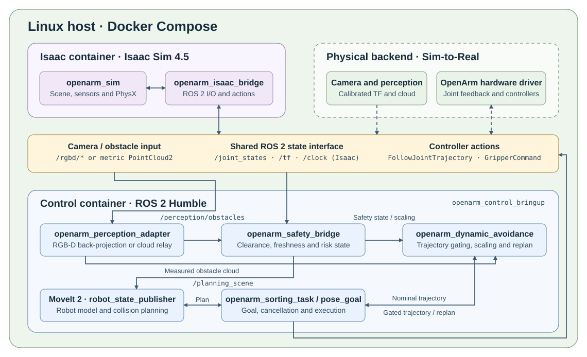

# Social Safety Decision

碩論 **Active Visual Perception and Dynamic Risk Assessment for Autonomous Robotic Manipulation** 的 OpenArm ROS 2 工作區。Docker Compose 啟動 Isaac Sim 和 ROS 2 Humble 控制容器。兩者透過相機資料、關節回饋及標準 ROS 2 action 連接，這組介面也用於後續真機接入。

## 系統流程圖



Isaac 發布 RGB-D 與機器人狀態。感知轉接將量測轉為 `/perception/obstacles`，安全橋接據此估算風險並更新 MoveIt 碰撞場景。目標節點向 MoveIt 請求規劃，經動態避障檢查後透過 `FollowJointTrajectory` 執行。圖中的虛線表示真機接入路徑，完整 topic 和 action 名稱見[介面表](docs/ARCHITECTURE.md)。

## ROS 2 工作區

```text
src/
├── realtime_3d_safety_decision/   點雲感知、障礙追蹤與自訂訊息
├── openarm_perception_adapter/    RGB-D、遮罩與量測點雲轉接
├── openarm_safety_bridge/          風險、資料時效及碰撞場景發布
├── openarm_dynamic_avoidance/      軌跡閘控、調速與重規劃請求
├── openarm_sorting_task/           目標、MoveIt 規劃與手臂 action
├── openarm_control_bringup/        共用控制、感知來源與後端選擇
├── openarm_sim/                    場景、相機、機器人資源與模擬設定
├── openarm_isaac_bridge/           Isaac 感測發布與模擬控制器 action
├── openarm_sim_bringup/            模擬 launch、MoveIt 場景與 RViz
├── hand_obstacle_controller/       模擬手部命令與測試情境
└── openarm_sim_evaluator/          模擬事件、真值與實驗量測
```

每個目錄都是有 `package.xml` 的 ROS 2 套件。Docker 透過 `openarm.repos` 取得另外兩個上游套件 `openarm_description` 和 `openarm_bimanual_moveit_config`，並以 `colcon build --base-paths src` 建置整個工作區。主機端可用 `colcon list --base-paths src` 查看套件。

## 執行 Isaac Sim

需要 Linux x86-64、Docker Compose、NVIDIA GPU 和 NVIDIA Container Toolkit。依 NVIDIA Omniverse 授權條款選擇 `ACCEPT_EULA`。

```bash
bash docker/build.sh
ACCEPT_EULA=Y docker compose --profile isaac up -d
docker compose exec -T control bash docker/entrypoint.sh python3 docker/verify_isaac.py
```

預設場景以 OpenArm 和程序生成的手部幾何測試 ROS 2 管線，`demo_rgbd` 使用既有的 RGB 顏色篩選與對齊深度。可將感知來源切換成已校正的障礙點雲，供 EdgeTAM、RGB 三維重建或之後的真機介接。

```bash
docker compose --profile isaac down
```

## 文件

| 文件 | 內容 |
|---|---|
| [系統介面](docs/ARCHITECTURE.md) | 節點分工、topic 與 Sim-to-Real 資料契約 |
| [Docker 與 Sim-to-Real](docs/DOCKER.md) | 建置、驗收、資料來源設定與真機接入 |
| [程式索引](docs/CODE_MAP.md) | 程式入口、感知模組、ROS 2 節點和實驗工具 |
| [歷史交付](docs/DELIVERABLES.md) | 公開分支、原始操作說明與實驗紀錄 |
| [Docker 驗收](results/docker_isaac_2026-11-24.md) | GPU、感知、規劃及 action 的實測結果 |

現有的 Gazebo、Isaac LAN、Koch 和 Tidybot 主機流程見[歷史操作手冊](docs/history/2026-10-15-host-workflows.md)。
