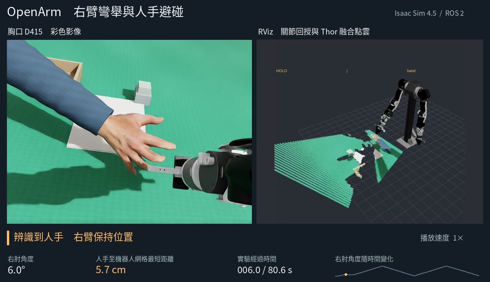
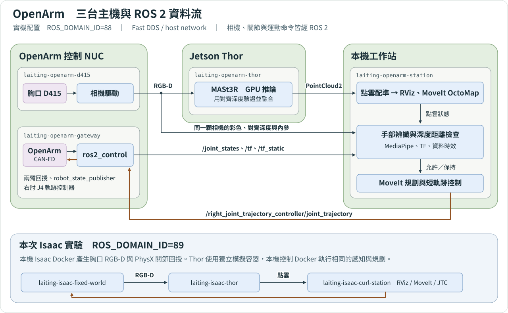

# Social Safety Decision

碩論 **Active Visual Perception and Dynamic Risk Assessment for Autonomous Robotic Manipulation** 的 OpenArm ROS 2 工作區。

## 單胸口相機的人手侵入實驗 · 2026-11-26

固定底座 OpenArm 在桌前重複抬放右臂。唯一一顆 D415 固定在胸口，向前下方看桌面與夾爪。模擬人手從桌子另一側伸入時，本機從 RGB-D 辨識人手並保持當下肘角。人手撤離且工作區持續淨空後，MoveIt 從最新關節回授重規劃，完成剩餘動作。這次驗證採用軟體停臂與恢復，實驗平台為 **Isaac Sim 4.5 + 實體 Jetson Thor**。

[](results/isaac_chest_curl_2026-11-26/openarm-chest-demo.mp4?raw=1)

**[28 秒示範影片](results/isaac_chest_curl_2026-11-26/openarm-chest-demo.mp4?raw=1)**　·　[81 秒原速全程](results/isaac_chest_curl_2026-11-26/openarm-chest-realtime.mp4?raw=1)　·　[逐步量測與重算方式](results/isaac_chest_curl_2026-11-26/README.md)

| 模擬量測 | 錄影場次 | 用 repo 模型重跑 |
|---|---:|---:|
| 完成抬起、放下 | 2 回合 | 2 回合 |
| 右肘實際角位移／夾爪上升 | 35.28°／18.69 cm | 35.23°／18.65 cm |
| 手與袖口至整台機器人的最短網格距離 | 5.44 cm | 5.58 cm |
| PhysX 手臂接觸事件／網格接觸步數 | 0／0 | 0／0 |
| 逐步檢查的物理步數 | 19,340 | 19,371 |

錄影中人手在最深處停留 3.20 秒。進入保持後，撤手前沒有新的抬放軌跡段。畫面的 RViz 是同一顆相機的三維觀察視角。人手動畫的位置和網格真值只供事後量測，線上停臂使用相機影像、深度、關節回授與點雲狀態。

## 三台主機與 Docker 配置



| 主機 | 實機部署容器／映像 | 本次模擬分工 |
|---|---|---|
| OpenArm 控制 NUC | `laiting-openarm-gateway`、`laiting-openarm-d415` 皆用 `laiting-openarm-robot:humble`。前者用 SocketCAN 讀雙臂、控制右肘，後者獨立綁定胸口 D415 的 USB、V4L2 裝置 | 由本機 Isaac 取代 NUC 的相機、編碼器與致動器 |
| Jetson Thor | `laiting-openarm-thor` 使用 `laiting-openarm-mast3r:jazzy`。NVIDIA GPU 執行 MASt3R，以 D415 對齊深度驗證點圖並融合 | `laiting-isaac-thor` 使用 `laiting-isaac-mast3r:jazzy`。獨立容器，6 CPU、16 GiB 記憶體 |
| 本機工作站 | `laiting-openarm-station` 使用 `laiting-openarm-safety:humble`，負責手部辨識、RViz、MoveIt、控制器切換和短軌跡 | `laiting-isaac-fixed-world` 使用 `social-safety-decision-isaac:4.5.0` 和本機 GPU，`laiting-isaac-curl-station` 使用 `laiting-isaac-curl-control:humble`，把 PhysX 接入相同的 ROS 2 控制介面 |

三端透過區網、Docker host network 與 Fast DDS 通訊。**模擬用 domain 89，實機用 domain 88**。同一批 JPEG、PNG 深度和內參以拍攝時戳配對。工作站的 RViz 使用 X11，Isaac 採 headless 渲染。容器僅掛載各自需要的模型、輸出或裝置。

## ROS 2 實驗流程

| 從哪裡到哪裡 | ROS 2 介面與用途 |
|---|---|
| 胸口相機 → Thor、本機 | `/camera/d415/color/image_raw/compressed`、`/camera/d415/aligned_depth_to_color/image_raw/compressedDepth`、`/camera/d415/color/camera_info`。深度為 16 位元毫米，影像與點雲訂閱使用 Best Effort |
| Thor → 本機 | `/laiting/mast3r/points` 是經獨立深度樣本檢核的 MASt3R 點，`/laiting/mast3r/fused_points` 補入 D415 有效量測，`/laiting/mast3r/status` 提供品質與時戳 |
| 工作站 → RViz、MoveIt | 配準後的 `/laiting/scene/points` 保留光學射線原點。`/joint_states`、`/robot_description`、`/tf`、`/tf_static` 將點雲與雙臂模型放在同一座標系 |
| 停臂與恢復 | `/laiting/safety/state` 回報 `permit`、`reason`。手部深度落入右前臂掃掠區域 18 cm 內即要求保持。RGB-D 過期、缺少配準或點雲失效也會抑制動作 |
| 本機 → 手臂 | 連續淨空至少 1.3 秒後，呼叫 MoveIt `/plan_kinematic_path`，透過 `/right_joint_trajectory_controller/joint_trajectory` 送出 120 ms 的右肘軌跡段。保持期間持續讀取編碼器 |

## 重跑示範

在兩台主機各自的 repo 根目錄執行。以下適用於實驗室已建置映像的環境。首次建置、模型來源、顯示與網路設定見 [Isaac 實驗手冊](hardware/isaac_curl/README.md)。

**Thor**

```bash
bash hardware/isaac_curl/thor.sh up
```

**本機工作站**

```bash
ACCEPT_EULA=Y bash hardware/isaac_curl/demo.sh --cycles 2 --timeout 220
```

腳本會依序啟動模擬、錄製胸口影像與 RViz、檢查逐步間距，再輸出兩種速度的 MP4。執行結果在 `outputs/isaac_guarded/`。

## 接到實際 OpenArm

胸口相機 topic、Thor 的推論程式、本機的手部辨識、MoveIt 與軌跡訊息均可沿用。實機由 NUC 的 RealSense 與 CAN 驅動提供量測及致動。實際安裝的相機外參、工作姿態及可見範圍需在現場量測。模擬的彎舉設定為 36°，實機首測採 18°。NUC 預設從接近垂手的姿勢啟動。若要讓夾爪出現在胸口視野，可使用經現場量測的桌面起始姿態。NUC 和本機會核對同一份姿態檔，並保留抬肩支撐。這條交接路徑已用隔離的模擬關節驗證。實機的追蹤誤差與停臂距離留待現場驗收。[實機接入、校正與被動檢查](hardware/right_curl/README.md)

## 本次更新

- 加入單胸口 RGB-D、帶皮膚紋理的人手與衣袖，以及固定底座 OpenArm 的可重播桌面場景。
- 接上 Thor 點雲、RViz 與標準 ROS 2 關節控制器，記錄辨識、保持、撤手後重規劃和兩次實際關節抬放。
- 隨版本提供同步影片、驗證 JSON、原始量測包、模型版本及三台主機的建置手冊。手部模型來源與授權見 [LibHand 歸屬說明](hardware/isaac_curl/assets/libhand/ATTRIBUTION.md)。

## ROS 2 工作區

```text
src/
├── realtime_3d_safety_decision/   點雲感知、障礙追蹤與自訂訊息
├── openarm_perception_adapter/    RGB-D、遮罩與量測點雲轉接
├── openarm_safety_bridge/          風險、資料時效及碰撞場景發布
├── openarm_dynamic_avoidance/      軌跡閘控、調速與重規劃請求
├── openarm_sorting_task/           目標、MoveIt 規劃與手臂 action
├── openarm_control_bringup/        共用控制、感知來源與後端選擇
├── openarm_sim/                    場景、相機、機器人資源與模擬設定
├── openarm_isaac_bridge/           Isaac 感測發布與模擬控制器 action
├── openarm_sim_bringup/            模擬 launch、MoveIt 場景與 RViz
├── hand_obstacle_controller/       模擬手部命令與測試情境
└── openarm_sim_evaluator/          模擬事件、真值與實驗量測
```

每個目錄都是有 `package.xml` 的 ROS 2 套件。Docker 透過 `openarm.repos` 取得另外兩個上游套件 `openarm_description` 和 `openarm_bimanual_moveit_config`，並以 `colcon build --base-paths src` 建置整個工作區。主機端可用 `colcon list --base-paths src` 查看套件。

## 既有 Compose 整合測試

此入口使用 domain 87 的既有控制與模擬套件。其節點和 action 關係見[既有工作區系統圖](docs/architecture.svg)。需要 Linux x86-64、Docker Compose、NVIDIA GPU 和 NVIDIA Container Toolkit。依 NVIDIA Omniverse 授權條款選擇 `ACCEPT_EULA`。

```bash
bash docker/build.sh
ACCEPT_EULA=Y docker compose --profile isaac up -d
docker compose exec -T control bash docker/entrypoint.sh python3 docker/verify_isaac.py
```

預設場景以 OpenArm 和程序生成的手部幾何測試 ROS 2 管線，`demo_rgbd` 使用既有的 RGB 顏色篩選與對齊深度。可將感知來源切換成已校正的障礙點雲，供 EdgeTAM、RGB 三維重建或之後的真機介接。

```bash
docker compose --profile isaac down
```

## 文件

胸口相機實驗的校正、被動檢查和實機首測見[實機接入手冊](hardware/right_curl/README.md)。

| 文件 | 內容 |
|---|---|
| [系統介面](docs/ARCHITECTURE.md) | 節點分工、topic 與 Sim-to-Real 資料契約 |
| [Docker 與 Sim-to-Real](docs/DOCKER.md) | 建置、驗收、資料來源設定與真機接入 |
| [程式索引](docs/CODE_MAP.md) | 程式入口、感知模組、ROS 2 節點和實驗工具 |
| [歷史交付](docs/DELIVERABLES.md) | 公開分支、原始操作說明與實驗紀錄 |
| [Docker 驗收](results/docker_isaac_2026-11-24.md) | GPU、感知、規劃及 action 的實測結果 |

現有的 Gazebo、Isaac LAN、Koch 和 Tidybot 主機流程見[歷史操作手冊](docs/history/2026-10-15-host-workflows.md)。
