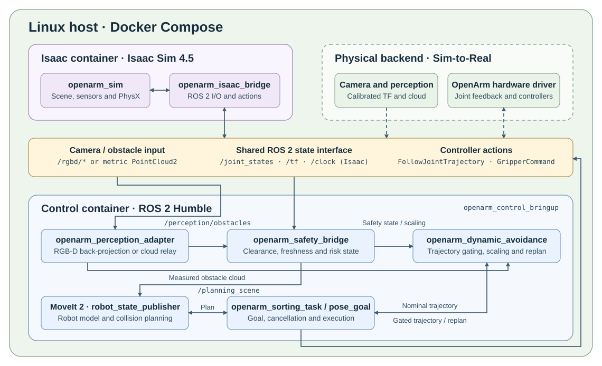

# 系統架構

Isaac Sim、相機驅動與 OpenArm 驅動提供 ROS 2 I/O。控制容器依相同的關節名稱、座標框架、時間戳與動作介面執行風險評估及規劃。切換後端時，場景、感測器與關節驅動換成實體來源。

## ROS 2 套件分工

| 套件 | 職責 |
|---|---|
| `realtime_3d_safety_decision` | 感測、點雲跟蹤、EdgeTAM 節點及 `TrackedObstacleArray` 訊息。 |
| `openarm_perception_adapter` | 將同幀 RGB-D 與遮罩轉成公尺制點雲，或轉發外部量測點雲。 |
| `openarm_safety_bridge` | 依量測時刻轉換 TF，算機器人間距、發布安全狀態及規劃場景障礙物。 |
| `openarm_dynamic_avoidance` | 依安全結果暫停或調整軌跡，必要時請求重新規劃。 |
| `openarm_sorting_task` | `pose_goal` 管理上層目標、MoveIt 規劃和 trajectory action。保留舊的顏色分揀節點。 |
| `openarm_control_bringup` | 選擇 Isaac 或硬體後端、時間基準、感知來源與任務節點。 |
| `openarm_sim` | 場景、影像與深度相機設定、模型、手部路徑及模擬工具。 |
| `openarm_isaac_bridge` | 用 ROS 2 發布 Isaac 感測與關節回饋，把 action 目標送入 PhysX articulation。 |
| `openarm_sim_bringup` | Isaac 專用 MoveIt 模型及規劃場景、既有 Isaac 和 Gazebo launch 與 Gazebo 轉接。 |
| `hand_obstacle_controller` | 舊場景的假手命令、服務及鍵盤。 |
| `openarm_sim_evaluator` | 記錄模擬真值、感知／控制事件與評估結果。 |

## Sim-to-Real 介面

| 訊號 | ROS 2 合約 |
|---|---|
| RGB、CameraInfo、對齊深度 | `/rgbd/color/image_raw`、`/rgbd/color/camera_info`、`/rgbd/aligned_depth_to_color/image_raw`。深度為 `32FC1` 公尺，與 RGB 對時並共用光學座標。點雲模式可直接接 RGB 重建的輸出。 |
| 障礙 | `/perception/obstacles`，型別為 `sensor_msgs/msg/PointCloud2`。保留量測時間、已校正的 `frame_id` 和以公尺為單位的 xyz。即使只有空雲，也須來自有效的觀測。 |
| 關節回饋 | `/joint_states`，型別為 `sensor_msgs/msg/JointState`。關節名稱與驅動、URDF、MoveIt、任務設定一致。 |
| 目標 | `/openarm/target_pose`，型別為 `geometry_msgs/msg/PoseStamped`，配合 `/openarm/task/command`。目前共用入口的 `move_target` 對應左臂。 |
| 手臂與夾爪 | 每臂 `FollowJointTrajectory` 與 `GripperCommand` action 之名稱見 [openarm.yaml](../src/openarm_sim/config/openarm.yaml)。 |
| 時間 | Isaac 使用 `/clock`，硬體使用實機時間。影像、點雲、TF 與關節皆使用同一時間基準。 |

共用控制以已量測的感知資料為障礙來源，啟動先等待有效觀測，拒絕過期與重複時間戳的障礙輸入。模擬真值走 `/sim/ground_truth/*` 到評估工具。

## Isaac 場景模組

`src/openarm_sim/config/scene.yaml` 描述環境與物件，`camera.yaml` 描述相機，`openarm.yaml` 描述機器人與控制介面，`hand_scenarios.yaml` 描述入侵位置與時序。場景由 `isaac_scene.py` 組裝，`hand_runtime.py` 以與 Isaac 無關的方式處理腳本及手動命令，`openarm_isaac_bridge` 專責感測與控制 I/O。硬體接入步驟見 [Docker 與 Sim-to-Real](DOCKER.md)。
