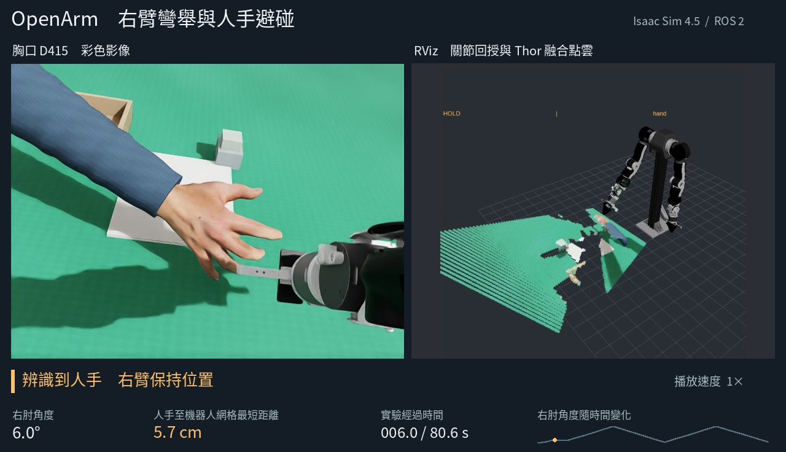

# 2026-11-26　胸口 D415 與人手侵入

本次以 Isaac Sim 4.5 的固定底座 OpenArm、桌子、人手和衣袖建立場景。工作站使用 RTX 4060 Ti，Jetson Thor 執行真實 MASt3R 模型。錄影包含兩次完整彎舉與一次伸手；第二場使用從 repo 重建的模型和同一套腳本獨立重跑。

**[示範影片（28 秒）](openarm-chest-demo.mp4?raw=1)**　·　[原速全程（約 81 秒）](openarm-chest-realtime.mp4?raw=1)　·　[無人手的胸口原圖](chest-camera.jpg)　·　[RViz 全視窗](chest-rviz.png)



## 從伸手到恢復

以下秒數以錄影場次第一個物理樣本為零點；圖中的 `HOLD` 分別與 ROS 狀態及控制器記錄對照。

| 經過時間 | 量測事件 |
|---:|---|
| 1.60 s | 開始第一趟右肘上抬 |
| 4.06 s | 模擬人手從桌子另一側伸入 |
| 4.90 s | 從影像辨識並在掃掠區判定有人手，控制器送出保持位置 |
| 5.01–8.21 s | 人手停留在最深位置，保持後沒有新的運動軌跡段 |
| 9.27 s | 人手回到停放位置 |
| 10.06 s | 重新取得規劃路徑後，從當前角度繼續第一趟上抬 |
| 44.10 s、80.64 s | 第一、第二次抬放完成；80.67 s 回到起始區間並釋放模擬控制器 |

工作區的連續淨空時間從影像判定人手離開掃掠區時計起。人手可已離開掃掠區但仍在撤回途中。4.90 s 至 5.01 s 的差值是「保持命令到手到達最深處」的時間。

## 結果與判定

| 指標 | 錄影場次 | 重跑場次 |
|---|---:|---:|
| 右肘起始角／最高角 | 1.72°／37.00° | 1.72°／36.94° |
| 夾爪上升高度 | 18.69 cm | 18.65 cm |
| 人手在最深處停留 | 3.20 s | 3.18 s |
| 穩定保持時段的右肘角度範圍 | 0.34° | 0.28° |
| 全程最短網格間距 | 5.44 cm | 5.58 cm |
| 人手或衣袖接觸機器人的物理步數 | 0 / 19,340 | 0 / 19,371 |
| PhysX 手與機器人的接觸回報 | 0 | 0 |

「最短間距」取手與袖口三角網格到整台機器人所有 URDF 碰撞網格的最小表面距離。FCL 在每個 1/120 秒物理步，用 PhysX 關節回授重建姿態；兩場最近處都是右夾爪的 `openarm_right_right_finger`。網格距離與 PhysX 接觸回報各自計算。穩定保持的角度範圍從人手停在最深處後 250 ms 算起。感知、控制和影片對時採壁鐘，物理步長採模擬時間。數值適用於本次人手形狀、速度、路徑與相機視野。[錄影場次的逐項檢查](validation.json) · [模型重建後的逐項檢查](replication.json)

另一次 10 秒的 ROS 2 通訊觀測量到 `/joint_states` 50.0 Hz、配對胸口 RGB-D 16.32 Hz、Thor 點雲 2.86 Hz，每幀融合點數中位數 12,288。MASt3R 在獨立深度樣本上的誤差中位數為 6.8 mm。這是點雲相對深度的檢核。[原始通訊觀測](ros-topics.json)

## 實機介面的隔離檢查

以無外部網路、無 CAN 裝置的 Docker 將相同控制程式接到模擬關節。用真實手部照片回放時，手部辨識要求保持；切斷 RGB-D 或許可心跳也能停臂。回授恢復後重新規劃、完成兩回合。另以 mock NUC 驗證桌面姿態檔的七個角度與摘要；變更姿態或外參檔會使配對失效。CAN 驅動外掛另已編譯安裝。這些檢查涵蓋軟體交接，實機煞停距離仍需現場量測。

## 離線重算影片場次

[量測 ZIP](measurements.zip) 含 `physics.csv`、`commands.csv`、`clearance.csv`、錄影時間戳、PhysX 接觸事件、USD 相機外參、展開的 URDF 和手部幾何。檔案摘要見 [SHA256SUMS](SHA256SUMS)。

在 repo 根目錄執行。執行環境使用模擬控制映像，重算過程只需模型與 ZIP。

```bash
bash hardware/right_curl/fetch_model.sh
docker run --rm --network none --tmpfs /audit:rw,mode=1777 \
  -v "$PWD/results/isaac_chest_curl_2026-11-26:/evidence:ro" \
  -v "$PWD/.openarm-vendor/nuc-v10-description:/model:ro" \
  -v "$PWD/hardware/isaac_curl:/app:ro" \
  laiting-isaac-curl-control:humble bash -ec '
    python3 -m zipfile -e /evidence/measurements.zip /audit
    python3 /app/validate.py /audit
    cmp /evidence/validation.json /audit/validation.json'
```

胸口畫面由 Isaac RTX 渲染，另一側為實際 RViz 視窗。影片疊字採控制器事件和事後量出的距離。手部模型由 Marin Šarić 製作，改作自 LibHand 0.9 的展開手姿，加入衣袖與伸手動畫。[來源及 CC BY 3.0 授權](../../hardware/isaac_curl/assets/libhand/ATTRIBUTION.md)
